

  

<h1 align="center">Расписание НТМТ</h1>

  Неофициальное приложение для Android. Расписание с публичной страницы <a href="https://nti.urfu.ru/schedule-ntmt">nti.urfu.ru/schedule-ntmt</a>. 
  Создано с помощью Claude Code | Grok Build.

  

## Возможности

- Расписание на сегодня, неделю и звонки
- Виджет на рабочий стол
- Быстрое переключение на вторую группу
- Последнее расписание остаётся, если нет сети
- Личный кабинет: «Мои файлы», скачивание и загрузка файлов

## Новое в 2.1

- Расписание на завтра: после последней пары и в пустое воскресенье сразу показывается следующий учебный день
- Передача расписания и файлов по QR-кодам и NFC
- Резервная копия учебных файлов в zip, в фоне раз в день, неделю или месяц
- Папка для скачанных файлов на выбор
- Значок профиля в кабинете на выбор

## Личный кабинет

Логин и пароль можно сохранить на устройстве. Без блокировки экрана приложение вход не запоминает.

Данные лежат в закрытом файле приложения и шифруются AES-256-GCM. Ключ создаётся в Android Keystore и с телефона не уходит. При открытии кабинета система просит отпечаток, лицо или код, после этого выполняется вход сохранёнными данными. Если запоминание выключено, файл удаляется.

Резервной копии кабинета нужен вход без участия пользователя. Для неё пароль хранится отдельно, под своим ключом Keystore. Эта копия создаётся только после подтверждения отпечатком при выборе папок и удаляется, если выключить копии или забыть вход.

## Установка

Нужен Android 8.0 или новее.

При установке APK Google Play защита может написать, что приложение не проверено. Так помечаются файлы не из магазина. В окне нажмите «Подробнее», затем «Всё равно установить».

После установки рекомендуется разрешить фоновую работу для корректной работы уведомлений и резервных копий.

## Скриншоты

Светлая тема

  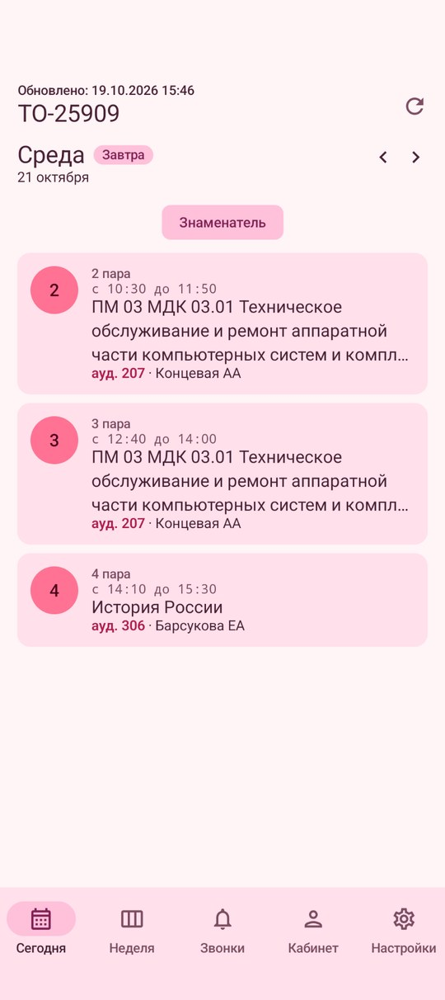
  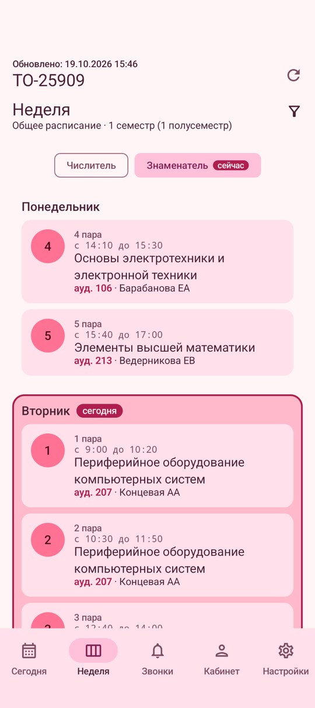
  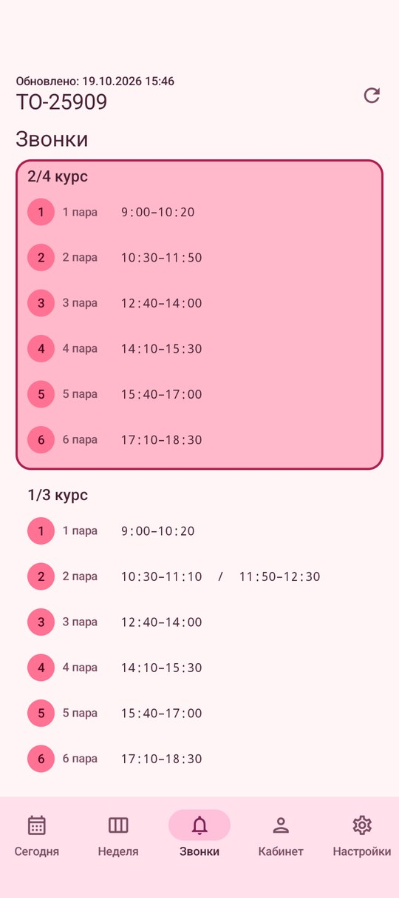
  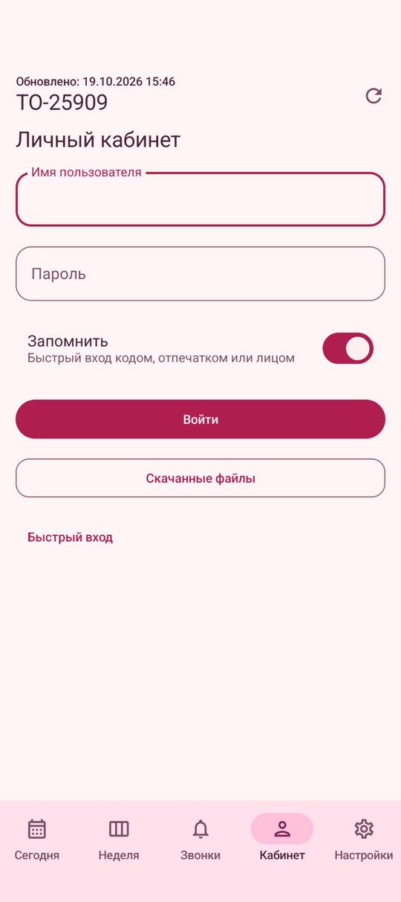
  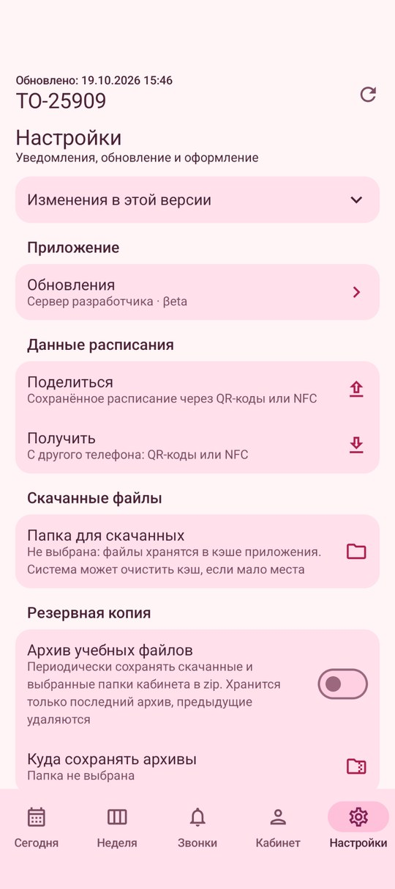

Тёмная тема

  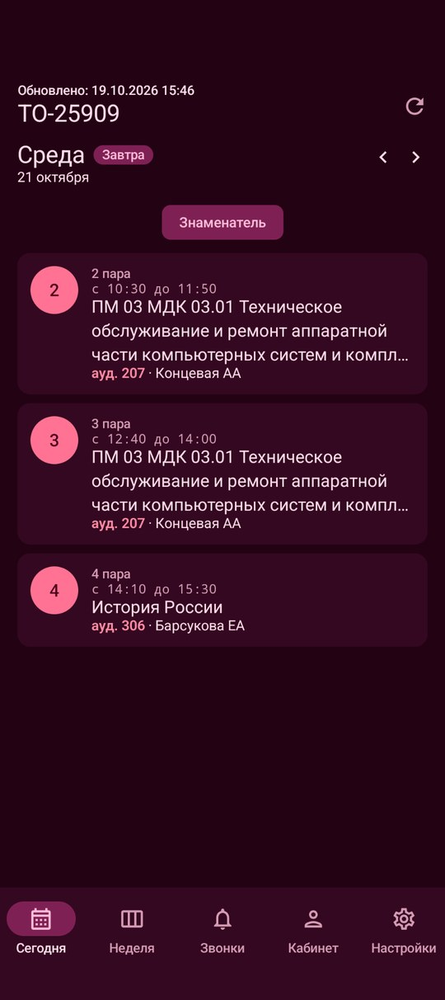
  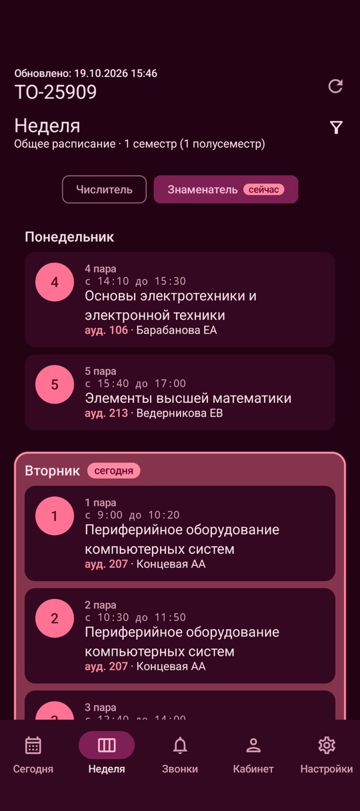
  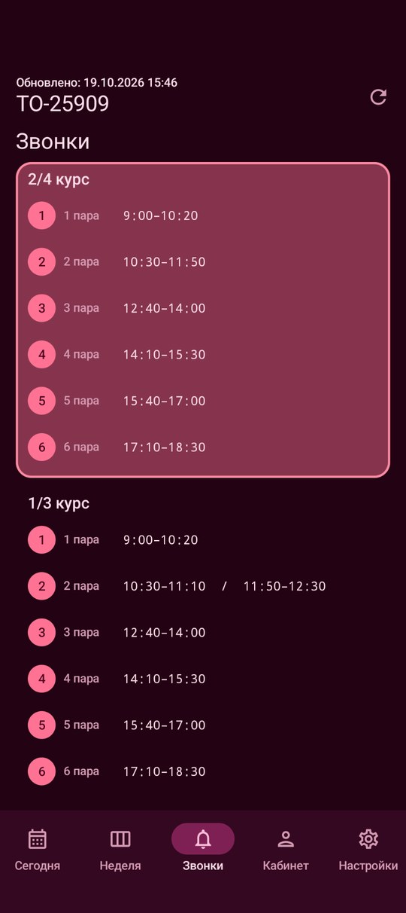
  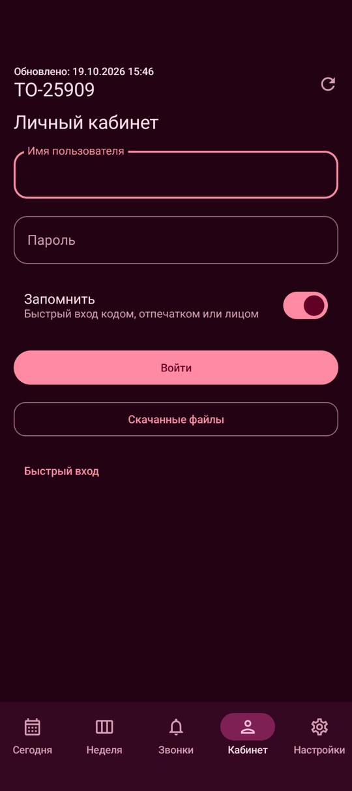
  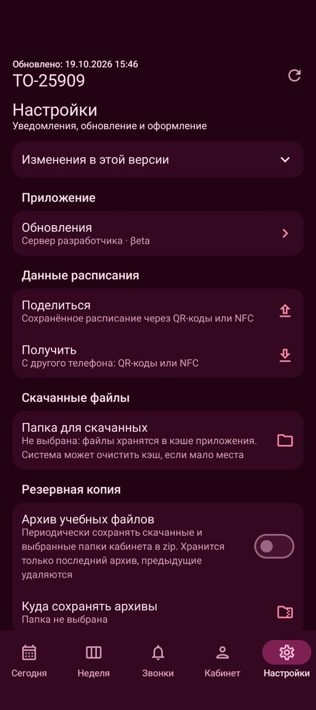

Виджет

  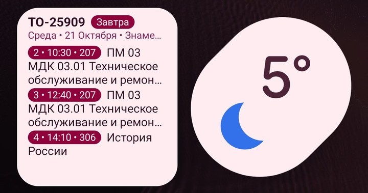
  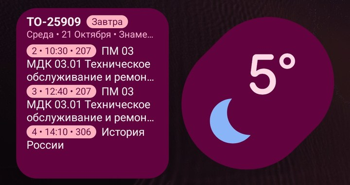

## Обновление приложения

Два канала: Stable и βeta.
Канал βeta имеет нестабильные пакеты с функциями в раннем доступе.
Обновления приходят из релизов GitHub этого репозитория.

## Сборка

Kotlin и Jetpack Compose, Gradle 8.

Ключ подписи в репозиторий не входит. Для release-сборки укажите его в `local.properties` (`ntmt.store.file`, `ntmt.store.password`, `ntmt.key.alias`, `ntmt.key.password`) или в переменных окружения `NTMT_STORE_FILE`, `NTMT_STORE_PASSWORD`, `NTMT_KEY_ALIAS`, `NTMT_KEY_PASSWORD`.
